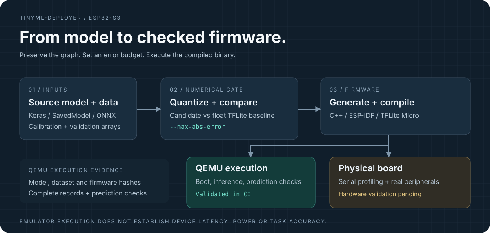
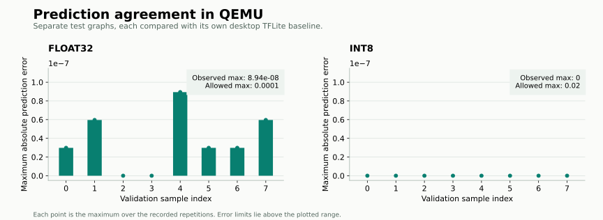
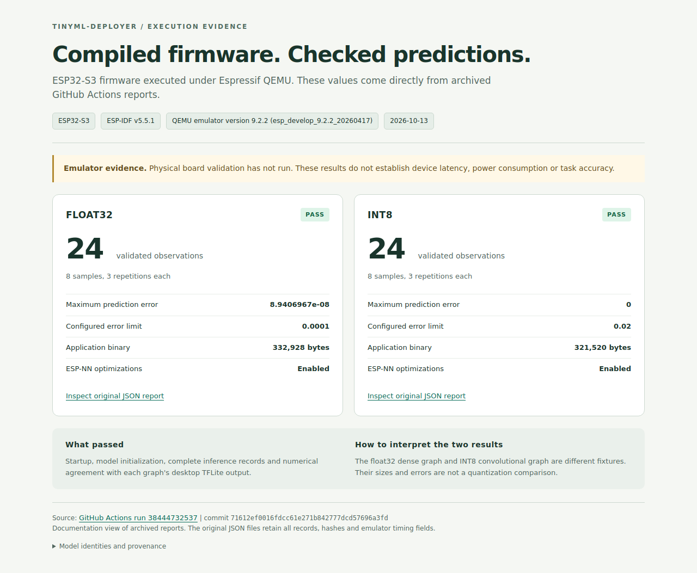
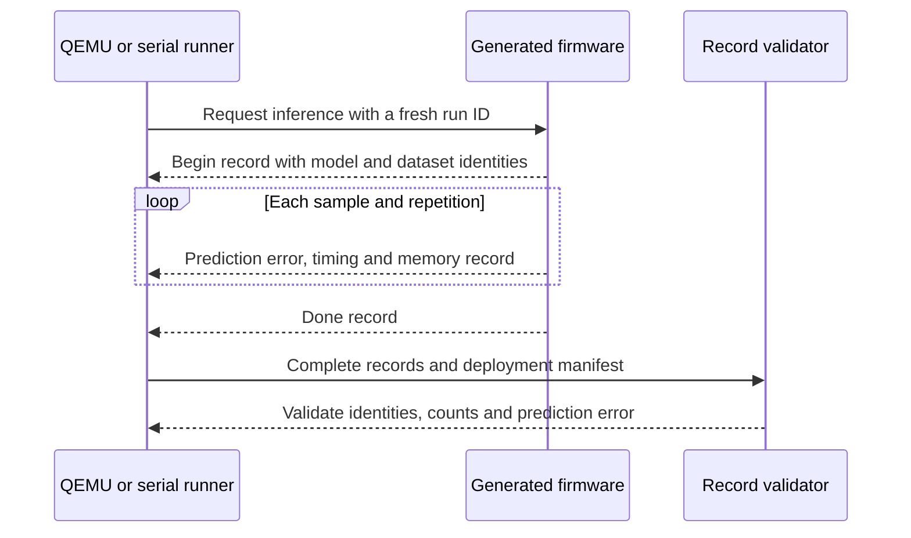

# tinyml-deployer

**Validate models. Generate ESP-IDF firmware. Check inference on ESP32-S3.**

[](https://github.com/alexhaya4/tinyml-deployer/actions/workflows/ci.yml)
[Python 3.11 / 3.12](pyproject.toml)
[MIT license](LICENSE)

A Python CLI that takes an original neural-network graph through quantization, prediction checks, C++ firmware generation and execution validation. Use Espressif QEMU without a board, or collect serial measurements from a connected device.



[Get started](#get-started) · [Verified results](#verified-results) · [Use QEMU](#test-without-a-board) · [Model requirements](#model-requirements) · [Architecture](#architecture) · [Migration guide](docs/migration-0.2.md)

> **Current status:** 0.2 development version, installed from source. ESP32-S3 float32 and INT8 firmware builds and QEMU execution are verified in CI. Physical-board validation remains pending. The published 0.1 package has a different interface.

## Why this project

Moving a model onto a microcontroller requires evidence at each boundary: conversion, memory allocation, compilation and execution. tinyml-deployer makes those boundaries explicit.

| Capability | What it provides |
| --- | --- |
| Quantization with an error budget | Compare candidate predictions with a float TFLite baseline on supplied validation samples before writing a model |
| Model-specific firmware | Generate C++ sources, register the graph's built-in operators and check input/output buffer sizes and runtime errors |
| Explicit resource limits | Require a tensor-arena reservation and generate an application partition with a defined flash budget |
| Execution without a board | Boot the compiled ESP32-S3 binaries in pinned Espressif QEMU with ESP-NN optimizations retained |
| Traceable reports | Record model and dataset identities, complete inference observations and numerical agreement; emulator reports also identify firmware and emulator binaries |

## Verified results

The following snapshot comes from [CI run 38444732537](https://github.com/alexhaya4/tinyml-deployer/actions/runs/38444732537), testing commit [`71612ef`](https://github.com/alexhaya4/tinyml-deployer/commit/71612ef0016fdcc61e271b842777dcd57696a3fd) on 13 October 2026. All eight CI jobs passed. Each QEMU job also passed 12 emulator tests, including real-process identity-mismatch and timeout checks.

| Evidence | Float32 dense graph | INT8 convolutional graph |
| --- | ---: | ---: |
| Completed inference observations | 24 | 24 |
| Validation samples × repetitions | 8 × 3 | 8 × 3 |
| Maximum prediction error | 8.94069672e-08 | 0 |
| Configured maximum error | 0.0001 | 0.02 |
| Application binary size | 332,928 bytes | 321,520 bytes |
| ESP-NN optimizations | Enabled | Enabled |
| Prediction agreement | Passed | Passed |

These are **different integration-test graphs**, each compared with desktop execution of its own deployed TFLite model. The table does not measure quantization savings, task accuracy or physical-board performance. Zero INT8 difference applies only to these supplied observations.



### Inspect the evidence



*Actual browser capture of the [documentation evidence view](docs/evidence/qemu-2026-10-13/index.html). All displayed measurements are read from the original CI JSON reports. This is a documentation view, not a separate application UI.*

The reports are preserved in this repository, so you can inspect them without downloading temporary Actions artifacts:

- [Float32 report](docs/evidence/qemu-2026-10-13/float32.json)
- [INT8 report](docs/evidence/qemu-2026-10-13/int8.json)
- [Source run, artifact IDs and checksums](docs/evidence/qemu-2026-10-13/provenance.json)
- [How the visuals are generated](docs/visuals.md)

## Get started

Use **Python 3.11 or 3.12**. TensorFlow is pinned to 2.19.1. Firmware uses ESP-IDF 5.5.1, `espressif/esp-tflite-micro` 1.4.1 and ESP-NN 1.4.1.

```bash
git clone https://github.com/alexhaya4/tinyml-deployer.git
cd tinyml-deployer
python -m venv .venv
```

Activate the environment:

```bash
# Linux / macOS
. .venv/bin/activate
```

```powershell
# Windows PowerShell
.venv\Scripts\Activate.ps1
```

Then install the CLI:

```bash
python -m pip install -e .
tinyml-deployer --help
# Optional ONNX conversion dependencies:
python -m pip install -e '.[onnx]'
```

For firmware builds, install and export [ESP-IDF 5.5.1](https://docs.espressif.com/projects/esp-idf/en/v5.5.1/esp32s3/get-started/index.html) in your build shell. Run `tinyml-deployer doctor --report environment.json` to check dependencies and build tools. Add `--onnx` for the conversion dependencies. A failed check exits nonzero.

The CLI's Python environment and IDF's environment may be separate. If exporting IDF changes the active Python, invoke the CLI using its virtual environment's absolute executable path.

## Run the full workflow

The included [sine example](examples/sine_model/README.md) exercises the complete integration using a mathematical function. It saves the original Keras model and separate calibration and validation arrays. It is not an application-accuracy benchmark.

### 1. Train, quantize and inspect

```bash
python examples/sine_model/train.py --output sine_artifacts

tinyml-deployer quantize sine_artifacts/sine.keras \
  --type int8 --calibration sine_artifacts/calibration.npy \
  --validation sine_artifacts/validation.npy --max-abs-error 0.05 \
  --output sine_artifacts/sine_int8.tflite --report quantization.json

tinyml-deployer analyze sine_artifacts/sine_int8.tflite --target esp32s3
```

### 2. Generate and compile firmware

```bash
tinyml-deployer deploy sine_artifacts/sine_int8.tflite --target esp32s3 \
  --arena-size 65536 --validation sine_artifacts/validation.npy \
  --max-abs-error 0.01 --repetitions 10 --output sine_project

idf.py -C sine_project set-target esp32s3
idf.py -C sine_project build
```

The example reserves 65,536 bytes for the arena. This is an explicit reservation, not a measured minimum. Choose your own reservation and error limits for your model and output units.

### 3. Execute in QEMU or on a board

With the emulator installed as described below:

```bash
tinyml-deployer emulate sine_project --report emulation.html
```

With an ESP32-S3 connected, substitute its actual serial port:

```bash
idf.py -C sine_project -p /dev/ttyUSB0 flash
# Close any serial monitor before profiling.
tinyml-deployer profile --port /dev/ttyUSB0 \
  --manifest sine_project/deployment.json --report device-results.html
```

The error gates answer two separate questions:

| Gate | Comparison |
| --- | --- |
| `quantize --max-abs-error` | Candidate TFLite model versus the float TFLite baseline |
| `deploy --max-abs-error`, enforced by `emulate` or `profile` | Firmware predictions versus desktop execution of the same deployed model |

A failed quantization gate writes no model. A completed execution that exceeds its prediction-error limit writes its report and exits nonzero. Crashed, incomplete or mismatched emulator runs fail without a success report. All output files and project directories must be new; existing artifacts are preserved.

## Test without a board

**Use GitHub CI with no local emulator installation.** Open an [Actions run](https://github.com/alexhaya4/tinyml-deployer/actions/workflows/ci.yml), select **Summary**, and scroll to **Artifacts**. The `emulation-float32-esp32s3` and `emulation-int8-esp32s3` ZIPs each contain `emulation-results.json`.

For local execution, use Linux or Linux through WSL2. Install the Python extra and the pinned Espressif QEMU release using the [emulator setup guide](docs/emulation.md):

```bash
python -m pip install -e '.[emulation]'
tinyml-deployer emulate sine_project \
  --qemu /absolute/path/to/qemu-system-xtensa \
  --timeout 120 --report emulation.json
```

The validated release is `esp_develop_9.2.2_20260417`, including ESP32-S3 vector-instruction fixes. The older emulator selected by ESP-IDF 5.5.1's installer is not the validated release for this workflow.

QEMU executes the actual compiled firmware, including optimized kernels. The runner checks model/dataset identity, requires a fresh complete run and terminates the process on completion or failure. It preserves the original project and build artifacts.

## Model requirements

| Area | Current contract |
| --- | --- |
| Quantization sources | Original `.keras`, TensorFlow SavedModel directory or `.onnx`; no reconstruction from `.tflite` graphs |
| Calibration | INT8 requires representative floating-point data already preprocessed for the model |
| Validation | Every quantization mode requires supplied samples and an explicit maximum absolute error |
| Data format | Non-pickled floating-point `.npy` arrays shaped `[N, *input_shape]`, including the model's batch dimension |
| Generated runtime | One input, one output, one subgraph, concrete fixed shapes, no variable tensors and registered built-in operators |
| Concurrency | Generated model calls must be externally serialized |

For a model input shaped `[1, 32, 32, 3]`, the dataset shape is `[N, 1, 32, 32, 3]`. INT8 input tensors are encoded using the model's scale and zero point.

Analysis, estimated benchmarking and deployment accept `.tflite` or `.onnx`. ONNX conversion uses pinned optional dependencies, with real ONNX Runtime versus TFLite tests in CI. Validate your own source-to-TFLite equivalence, tensor layout and preprocessing. Desktop conversion and resolver registration alone do not establish every Micro kernel's dtype/version compatibility.

### Target coverage

| Target | Current support | Evidence still needed |
| --- | --- | --- |
| ESP32-S3 | Generation, compiled float32/INT8 fixtures and QEMU execution | Physical-board profiling and application validation |
| ESP32, ESP32-C3, ESP32-C6 | Generation paths and static analysis | Separate toolchain, execution and board validation |
| STM32F4, STM32H7 | Analysis and analytical estimates | Board startup, linker and runtime integration; firmware generation currently rejects these targets |

## Architecture

The execution layer uses a fresh run ID and validates the firmware's complete record stream against the deployment manifest.



| Location | Responsibility |
| --- | --- |
| [`tinyml_deployer/analyzer.py`](tinyml_deployer/analyzer.py), [`operators.py`](tinyml_deployer/operators.py), [`targets.py`](tinyml_deployer/targets.py) | Inspect serialized operators, tensor metadata and nominal target profiles |
| [`converters.py`](tinyml_deployer/converters.py), [`quantizer.py`](tinyml_deployer/quantizer.py), [`evaluation.py`](tinyml_deployer/evaluation.py) | Convert source graphs, quantize and compare predictions |
| [`codegen.py`](tinyml_deployer/codegen.py), [`deployer.py`](tinyml_deployer/deployer.py), [`templates/`](tinyml_deployer/templates/) | Generate a checked C-callable C++ wrapper and ESP-IDF application |
| [`emulator.py`](tinyml_deployer/emulator.py), [`profiler.py`](tinyml_deployer/profiler.py) | Execute firmware and validate complete inference records |
| [`reporting.py`](tinyml_deployer/reporting.py), [`doctor.py`](tinyml_deployer/doctor.py) | Write portable reports and inspect the environment |
| [`tests/`](tests/), [`scripts/prepare_firmware_checks.py`](scripts/prepare_firmware_checks.py) | Behavioral tests, real conversion tests and compiled firmware fixtures |

## Commands and report interpretation

| Command | Purpose |
| --- | --- |
| `analyze MODEL --target TARGET` | Static model preflight |
| `quantize SOURCE --validation DATA --max-abs-error LIMIT ...` | Quantization with a numerical gate |
| `evaluate REFERENCE CANDIDATE --validation DATA --max-abs-error LIMIT --report PATH` | TFLite prediction comparison with MAE, RMSE and maximum error |
| `deploy MODEL --arena-size BYTES --validation DATA --max-abs-error LIMIT ...` | C++ firmware and deployment manifest generation |
| `benchmark MODEL --compare` | Analytical MAC-based estimates across nominal targets |
| `doctor [--onnx] [--report PATH]` | Dependency and ESP32-S3 build-tool checks |
| `emulate PROJECT --report PATH` | QEMU execution and prediction validation |
| `profile --port PORT --manifest PATH --report PATH` | Physical-device measurements over serial |

Reports support `.json` and standalone `.html`. In emulator reports, `measurement_kind` is `emulator` at the root and in `validation`; root fields `hardware_validation: not_run` and `hardware_timing_valid: false` keep the scope explicit. Emulator timing and memory observations describe the virtual execution.

Physical-device reports include raw observations, median/p95/maximum latency, arena usage and minimum free heap. The measured interval includes input copy, interpreter invocation and output copy, excluding warm-up and serial output. Model/dataset hashes and a fresh run ID reject stale or unrelated records. They provide traceability, not cryptographic attestation.

`benchmark` remains an estimate. Target flash capacities are nominal assumptions, and arena estimates do not precisely account for allocator and kernel scratch memory. Use linker output and execution evidence to establish fit. `--flash-budget` defaults to a 1 MiB application partition and must be aligned to 64 KiB; embedded validation vectors also consume flash. Manifests initially mark build and hardware execution as `not_run`; compilation does not silently change these fields.

## Development

```bash
python -m pip install -e '.[dev,onnx,emulation]'
ruff check tinyml_deployer tests scripts examples docs/build_visuals.py
pytest
python -m build
python -m twine check dist/*
python scripts/prepare_firmware_checks.py --output firmware_checks
```

CI tests Python 3.11/3.12, performs real ONNX conversions, compiles both firmware fixtures and runs both in QEMU. Real-process emulator tests require compiled firmware and QEMU; the ordinary suite skips them when a project is not supplied. See [CONTRIBUTING.md](CONTRIBUTING.md) and the [emulator guide](docs/emulation.md) for the required environment.

### Remaining milestones

- Validate both firmware paths on a physical ESP32-S3, documenting the board and flash configuration, allocation failures and serial reconnect behavior.
- Add an application backed by licensed recorded data, leakage-resistant dataset splits and measured task metrics. Motor-condition monitoring needs a defined sensor setup before it can be claimed as supported.
- Integrate and validate a concrete STM32 board and runtime before enabling STM32 firmware generation.

See the [0.2 migration guide](docs/migration-0.2.md) for breaking changes. Created by [Alex Odhiambo Haya](https://github.com/alexhaya4). [MIT licensed](LICENSE).
