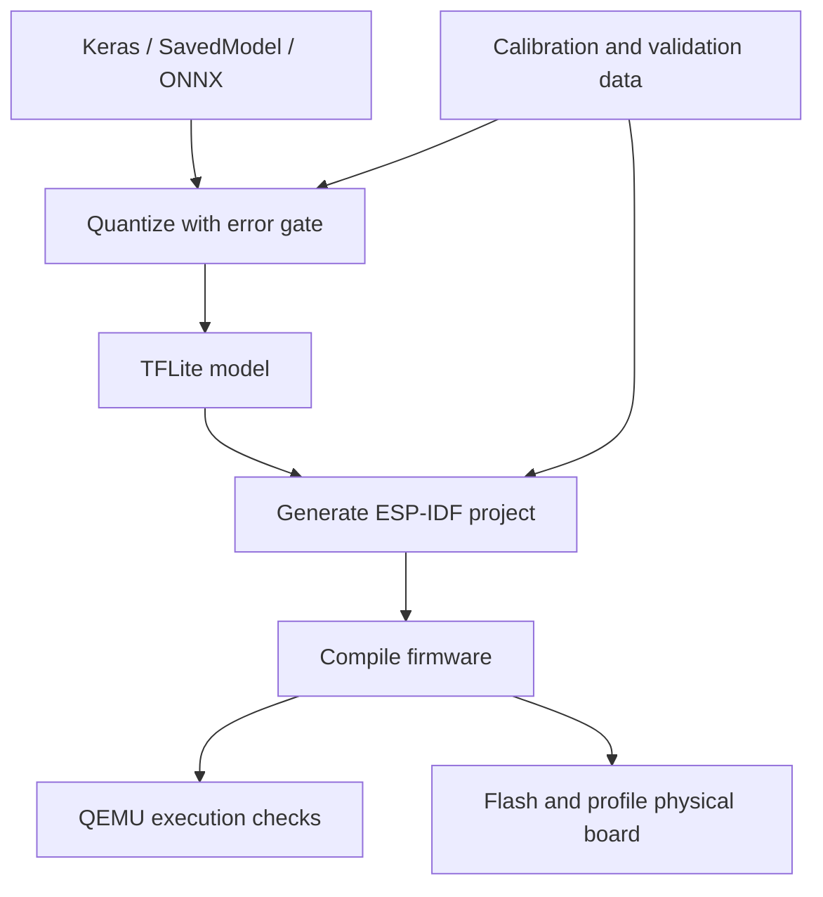

[](https://github.com/alexhaya4/tinyml-deployer/actions/workflows/ci.yml)
[](LICENSE)

# tinyml-deployer

Validate and quantize small neural networks, generate ESP-IDF inference firmware, and collect measurements from a connected device.

The 0.2 development workflow adds prediction error gates, model-specific C++ operator registration, explicit memory reservations, and serial profiling. It replaces the earlier TFLite reconstruction and incomplete STM32 scaffolding. Install this version from source; the published 0.1 release has a different interface.

## What gets checked

| Stage | Evidence produced | What still needs checking |
| --- | --- | --- |
| Analyze | Serialized operators and versions, tensor shapes, dtypes, nominal memory estimates | Micro kernel dtype/version support and actual memory allocation |
| Quantize | Float TFLite baseline versus candidate predictions on supplied samples | Task accuracy and whether the dataset represents deployment conditions |
| Generate | C++ wrapper, exact resolver registrations, validation vectors, deployment manifest | Compilation with the pinned toolchain |
| Build | ESP-IDF linker and partition size checks | Firmware execution |
| Emulate | Actual ESP32-S3 binary execution and prediction agreement under pinned QEMU | Physical timing, power and peripheral behavior |
| Profile | Device latency, arena usage, minimum free heap, prediction agreement | Application behavior under its real workload |



`benchmark` remains an analytical MAC-based estimate. It is not a measured benchmark. Flash capacities in the target registry are nominal board assumptions, and the arena estimate does not account precisely for Micro allocator or kernel scratch memory. Use linker output and device measurements to establish fit.

## Install

Use Python 3.11 or 3.12. TensorFlow is pinned to 2.19.1, including its matching TFLite schema APIs. Firmware targets ESP-IDF 5.5.1 and `espressif/esp-tflite-micro` 1.4.1 with ESP-NN 1.4.1.

```bash
git clone https://github.com/alexhaya4/tinyml-deployer.git
cd tinyml-deployer
python -m venv .venv
. .venv/bin/activate
python -m pip install -e '.[dev]'
# Optional ONNX conversion:
python -m pip install -e '.[dev,onnx]'
```

Install and export [ESP-IDF 5.5.1](https://docs.espressif.com/projects/esp-idf/en/v5.5.1/esp32s3/get-started/index.html) in the build shell. Then run `tinyml-deployer doctor --report environment.json` to check the build tools and Python dependencies. Add `--onnx` to check conversion dependencies. A failed check exits nonzero. The Python CLI environment and IDF's Python environment may be separate; use the CLI's absolute executable path when necessary.

## Reproducible workflow

The included [sine example](examples/sine_model/README.md) trains a mathematical function approximation and saves the original Keras model plus separate calibration and validation arrays. It is an integration example, not a real-world accuracy or hardware performance claim.

```bash
python examples/sine_model/train.py --output sine_artifacts

tinyml-deployer quantize sine_artifacts/sine.keras \
  --type int8 --calibration sine_artifacts/calibration.npy \
  --validation sine_artifacts/validation.npy --max-abs-error 0.05 \
  --output sine_artifacts/sine_int8.tflite --report quantization.json

tinyml-deployer analyze sine_artifacts/sine_int8.tflite --target esp32s3

tinyml-deployer deploy sine_artifacts/sine_int8.tflite --target esp32s3 \
  --arena-size 65536 --validation sine_artifacts/validation.npy \
  --max-abs-error 0.01 --repetitions 10 --output sine_project

cd sine_project
idf.py set-target esp32s3
idf.py build
idf.py -p /dev/ttyUSB0 flash
# Close any serial monitor before profiling.
tinyml-deployer profile --port /dev/ttyUSB0 \
  --manifest deployment.json --report device-results.html
```

The two error limits serve different purposes: quantization compares the quantized model to a float TFLite baseline, while device profiling compares firmware predictions to desktop execution of that same deployed model. Choose limits for your model's output units. A failed quantization gate writes no model. A complete device run that fails prediction agreement still writes its report and exits nonzero.

All generated output files and project directories must be new. Existing artifacts are preserved. Training also requires a new output directory.

## Testing without a physical board

The `emulate` command runs the already-built ESP32-S3 firmware under Espressif QEMU. It uses the same compiled binaries and preserves ESP-NN optimizations. It requires a complete fresh run, checks model/dataset identity and prediction error, and rejects crashes, timeouts and incomplete results. No alternative inference implementation or generated measurement data is substituted.

**GitHub CI requires no local installation.** The two `emulate-firmware` jobs execute the float32 and INT8 projects and upload `emulation-float32-esp32s3` and `emulation-int8-esp32s3` JSON report artifacts. They also test wrong-manifest rejection and timeout handling against real QEMU processes.

For local use, the runner is validated on Linux. Windows users can use GitHub CI or Linux through WSL2. Install the Python extra and the pinned [Espressif QEMU release](https://github.com/espressif/qemu/releases/tag/esp-develop-9.2.2-20260417):

```bash
python -m pip install -e '.[emulation]'
# Once the pinned QEMU executable and its runtime libraries are installed:
tinyml-deployer emulate sine_project --report emulation.json
# Or supply an explicit executable path:
tinyml-deployer emulate sine_project --qemu /path/to/qemu-system-xtensa \
  --timeout 120 --report emulation.html
```

The required QEMU version is `esp_develop_9.2.2_20260417`; it contains ESP32-S3 vector-instruction fixes relevant to optimized kernels. The older QEMU version selected by ESP-IDF 5.5.1's installer is not the validated emulator for this workflow. See [the emulator setup guide](docs/emulation.md) for verified installation commands.

Reports explicitly identify `measurement_kind: emulator`, `hardware_validation: not_run` and `hardware_timing_valid: false`, including in nested validation results. They preserve model/dataset identities, firmware and emulator hashes, raw observations, console output and whether ESP-NN optimizations were enabled. Timing and memory observations describe the emulated execution; they do not establish physical board performance. The original deployment manifest and build artifacts remain unchanged.

## Input data and supported models

- Quantization accepts original `.keras`, TensorFlow SavedModel directories, or `.onnx` sources. It does not reverse-engineer `.tflite` graphs.
- INT8 requires representative calibration data. Dynamic-range and float16 quantization still require validation samples and an error limit. Micro support varies by kernel and dtype; successful desktop conversion alone does not establish device compatibility.
- Analysis, estimated benchmarking, and deployment accept `.tflite` or `.onnx`. ONNX conversion uses a pinned optional dependency set. Conversion tests compare real ONNX Runtime and TFLite predictions. Check your own model's source-to-TFLite equivalence, including layout and preprocessing, before deployment.
- Data files are non-pickled `.npy` floating-point arrays in preprocessed model input units. Shape is `[N, *input_shape]`, including the model's batch dimension. A model with input `[1, 32, 32, 3]` needs data shaped `[N, 1, 32, 32, 3]`. INT8 tensors are encoded with the model's scale and zero point.
- Generation currently requires one input, one output, one subgraph, fixed concrete shapes, no variable tensors, and registered built-in operators. The generated wrapper checks buffer lengths and runtime errors. Calls must be externally serialized.
- `esp32s3` is the reference firmware build target. ESP32, ESP32-C3 and ESP32-C6 generation paths need separate toolchain and board validation. STM32F4 and STM32H7 retain analysis and estimates only; deployment rejects them until board startup, linker and runtime integration are implemented and verified.

## Reports and commands

| Command | Purpose |
| --- | --- |
| `analyze MODEL --target TARGET` | Static preflight, including operator versions in the Python result |
| `quantize SOURCE --validation DATA --max-abs-error LIMIT ...` | Quantize with a numerical gate; optional `--report` |
| `evaluate REFERENCE CANDIDATE --validation DATA --max-abs-error LIMIT --report PATH` | Compare two TFLite models using MAE, RMSE and maximum error |
| `deploy MODEL --arena-size BYTES --validation DATA --max-abs-error LIMIT ...` | Generate C++ firmware and `deployment.json` |
| `benchmark MODEL --compare` | Compare analytical estimates across nominal targets |
| `doctor [--onnx] [--report PATH]` | Inspect installed dependencies and ESP32-S3 build tools |
| `profile --port PORT --manifest PATH --report PATH` | Collect a complete device run with model/dataset identity checks |
| `emulate PROJECT --report PATH` | Execute a built ESP32-S3 project in pinned QEMU and validate predictions |

Reports support `.json` and standalone `.html`. Device reports include raw observations, median/p95/maximum latency, maximum numerical error, actual arena use and minimum free heap. Timing includes input copy, interpreter invocation and output copy; it excludes warm-up and serial output. A fresh run ID and model/dataset hashes reject stale or unrelated measurements. These checks establish traceability, not cryptographic attestation.

`--flash-budget` controls the generated application partition, defaults to 1 MiB and must be aligned to 64 KiB. Validation vectors consume flash. `--arena-size` reserves static RAM; it is a user-supplied reservation, not a measured minimum. Generated manifests initially mark firmware build and hardware execution as `not_run`; compilation does not silently promote either field.

## Project structure

| Module | Responsibility |
| --- | --- |
| `analyzer.py`, `operators.py`, `targets.py` | Serialized model inspection, resolver mapping and nominal target profiles |
| `converters.py`, `quantizer.py`, `evaluation.py` | Source conversion, quantization and prediction comparisons |
| `codegen.py`, `deployer.py`, `templates/` | Checked C-callable C++ wrapper and ESP-IDF profiling application |
| `profiler.py`, `reporting.py`, `doctor.py` | Serial measurements, portable reports and environment diagnostics |
| `tests/`, `scripts/prepare_firmware_checks.py` | Behavioral tests, real conversion tests and firmware build inputs |

## Development and remaining validation

```bash
python -m pip install -e '.[dev,onnx]'
ruff check tinyml_deployer tests scripts examples
pytest
python -m build
python -m twine check dist/*
python scripts/prepare_firmware_checks.py --output firmware_checks
```

CI tests Python 3.11/3.12, runs actual ONNX conversions, compiles generated float32 and INT8 ESP32-S3 projects, and executes both under pinned Espressif QEMU. The firmware check inputs are deterministic test graphs; their build artifacts are not evidence of measured device performance.

Hardware validation remains pending: run both builds on an ESP32-S3, record the board/flash configuration, collect profiling reports, and verify allocation failures and serial reconnect behavior. A motor-condition monitoring example requires an identified sensor setup, licensed recorded data, a subject/session-separated split and measured task metrics before it can be claimed as a supported application. STM32 firmware support also needs a concrete reference board and verified runtime integration.

See [CONTRIBUTING.md](CONTRIBUTING.md) for the validation workflow and [migration notes](docs/migration-0.2.md) for breaking changes. MIT licensed; see [LICENSE](LICENSE).
